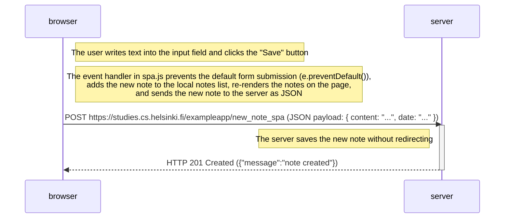

# Exercise 0.6: New note in Single page app diagram

Sequence diagram depicting the situation where the user creates a new note using the single-page version of the app at `https://studies.cs.helsinki.fi/exampleapp/spa`:

